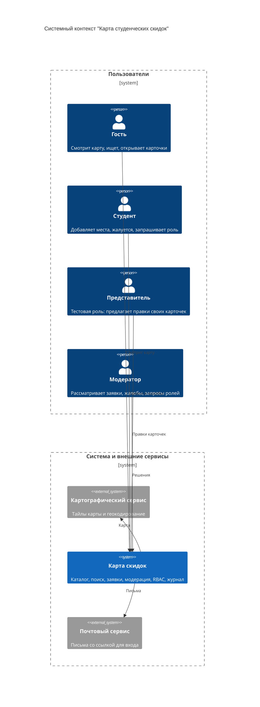
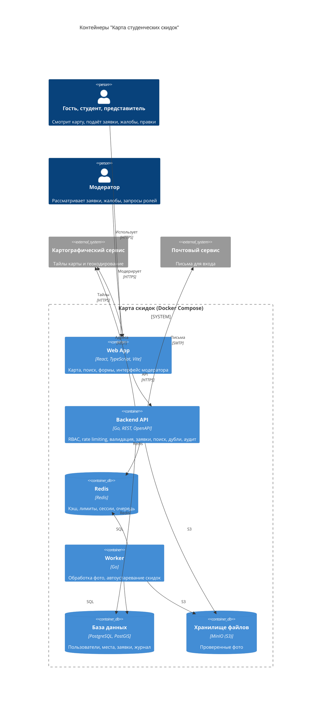
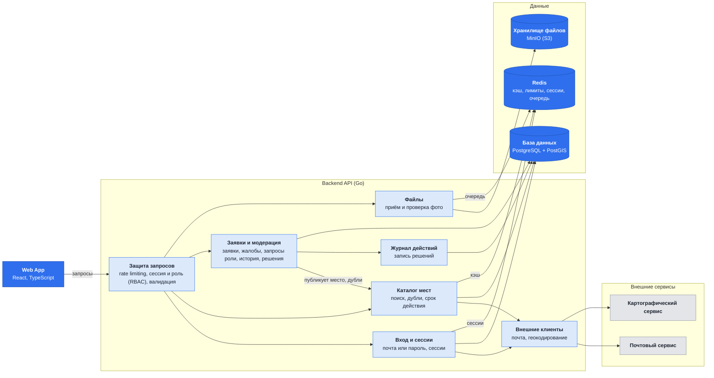
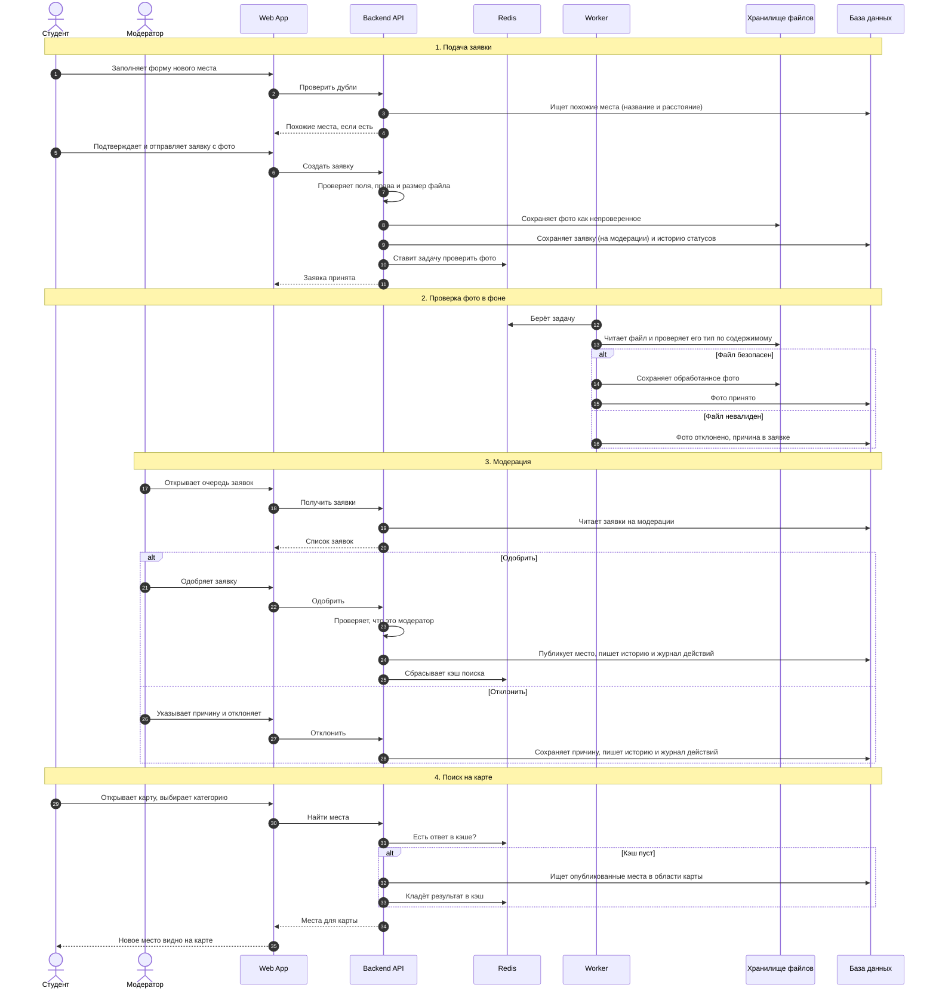

# Архитектура

Схемы построены по нотации C4 (уровни Context и Container), для компонентов бэкенда использована обычная схема, для сквозного сценария диаграмма последовательности. Стек: Go, PostgreSQL + PostGIS, Redis, MinIO (S3), React (Next.js).

## 1. Контекст

## 2. Контейнеры

## 3. Компоненты Backend API

## 4. Сквозной сценарий: заявка, модерация, поиск

